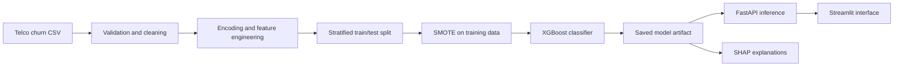
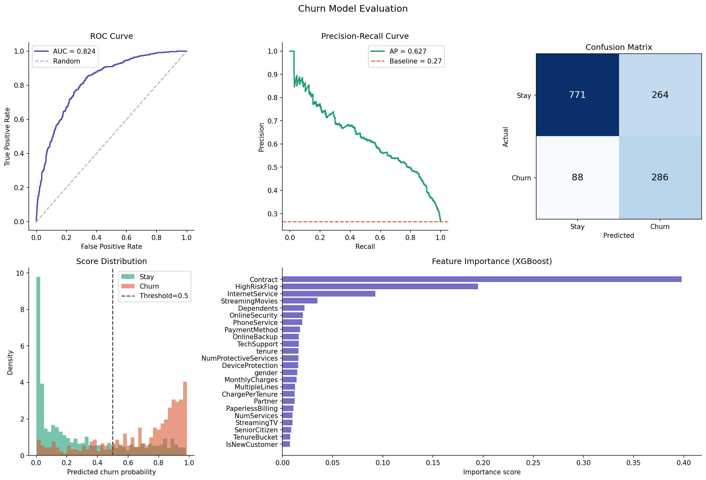

# Customer Churn Prediction

An end-to-end telco churn classification prototype built with XGBoost, FastAPI, Streamlit, SHAP, and Docker.

The project covers data validation, feature engineering, model training, evaluation, local explanations, API inference, and a small what-if interface. It is a portfolio prototype, not a production decision system.

## What is included

- A reproducible preprocessing and feature-engineering pipeline
- A stratified train/test split with SMOTE applied only to the training data
- XGBoost model training with MLflow logging hooks
- FastAPI endpoints for health checks, predictions, and model metadata
- Per-prediction SHAP feature contributions
- A Streamlit interface for exploring predictions and simple what-if inputs
- A Dockerfile for the inference API

## Architecture



## Current evaluation evidence

The committed `outputs/evaluation.png` reports the following results for the stored held-out test split:

| Metric | Value |
| --- | ---: |
| ROC AUC | 0.824 |
| Average precision | 0.627 |
| Positive-class prevalence | 0.27 |
| Confusion matrix at 0.5 | TN 771 · FP 264 · FN 88 · TP 286 |

These values describe the committed experiment only. Re-run the pipeline before treating them as the result of a new environment or code revision. The positive-class prevalence is the relevant no-skill reference for average precision; majority-class accuracy is not directly comparable with ROC AUC or average precision.



## Repository structure

```text
api/                 FastAPI application and request/response schemas
dashboard/           Streamlit interface
data/processed/      Committed processed train/test artifacts
models/              Saved XGBoost model
notebooks/           Exploratory analysis
outputs/             Evaluation and SHAP figures
src/                 Data, feature, training, evaluation, and explanation code
config.py            Paths and experiment settings
Dockerfile           API container definition
requirements.txt     Python dependencies
```

## Run the API locally

```bash
python -m venv .venv
source .venv/bin/activate
pip install -r requirements.txt
uvicorn api.main:app --host 0.0.0.0 --port 8000
```

Open `http://localhost:8000/docs` for the interactive API documentation.

Example request:

```bash
curl -X POST "http://localhost:8000/predict?customer_id=demo-001" \
  -H "Content-Type: application/json" \
  -d '{
    "tenure": 3,
    "MonthlyCharges": 89.5,
    "TotalCharges": 268.5,
    "Contract": 0,
    "InternetService": 2,
    "PaymentMethod": 0,
    "NumServices": 2,
    "NumProtectiveServices": 0,
    "IsNewCustomer": 1
  }'
```

The categorical values in this API are already encoded. See `src/feature_engineering.py` and `api/schema.py` before integrating another client.

The request schema derives `IsNewCustomer`, `TenureBucket`, `ChargePerTenure`, and `HighRiskFlag` from the submitted base fields so these transformations match the training pipeline. The remaining categorical values are already encoded.

## Run the Streamlit interface

Start the API first, then run:

```bash
streamlit run dashboard/app.py
```

The dashboard sends prediction requests to the API on port `8000`.

## Run with Docker

The current container packages the FastAPI service, not the Streamlit interface.

```bash
docker build -t churn-prediction-api .
docker run --rm -p 8000:8000 churn-prediction-api
```

## Rebuild the experiment

Place the expected raw CSV at `data/raw/WA_Fn-UseC_-Telco-Customer-Churn.csv`, then run:

```bash
python src/data_loader.py
python src/feature_engineering.py
python src/train.py
python src/evaluate.py
python src/explain.py
```

## Limitations

- The API accepts encoded fields rather than the raw dataset categories.
- The current model combines SMOTE with class weighting, while probability calibration has not been demonstrated.
- Dashboard what-if changes show how this model reacts to edited inputs; they are not estimates of intervention effects.
- SHAP values explain this model’s output; they do not establish causal effects.
- The committed model and processed data are artifacts of one experiment and should be regenerated after pipeline changes.
- Automated tests, continuous integration, calibration checks, drift monitoring, and authentication are not yet implemented.
- Dataset provenance and usage terms should be documented before a release is published.
